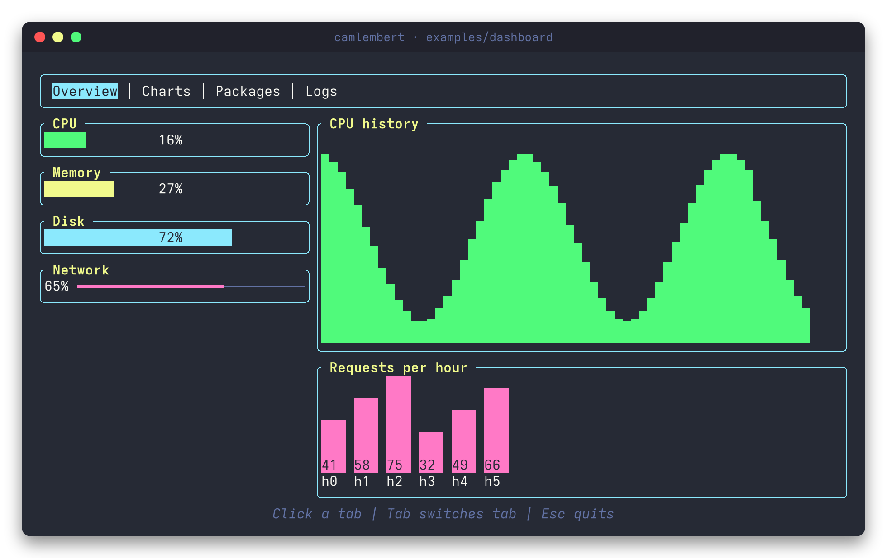
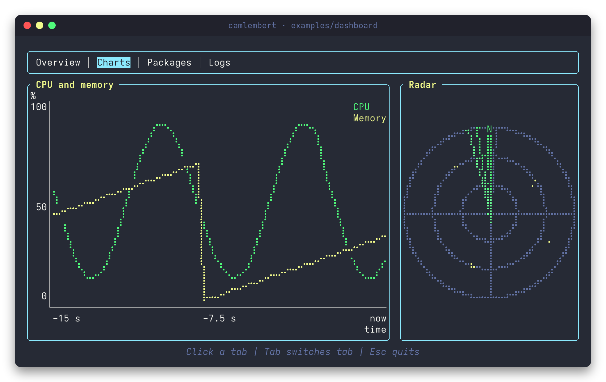
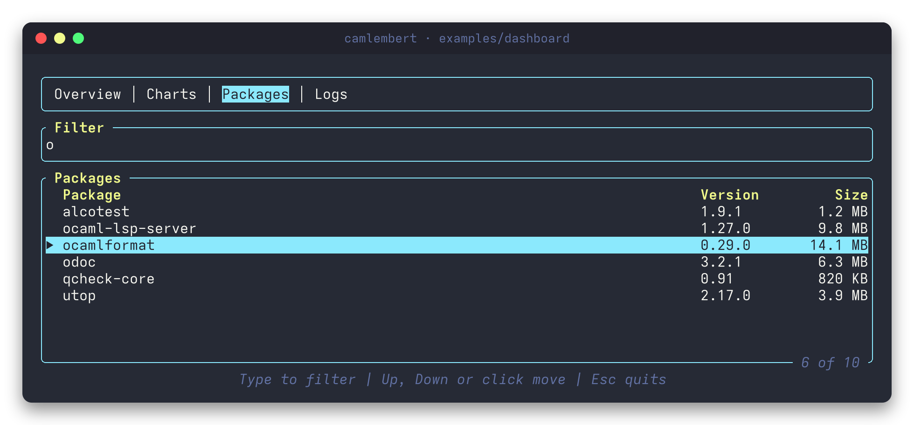
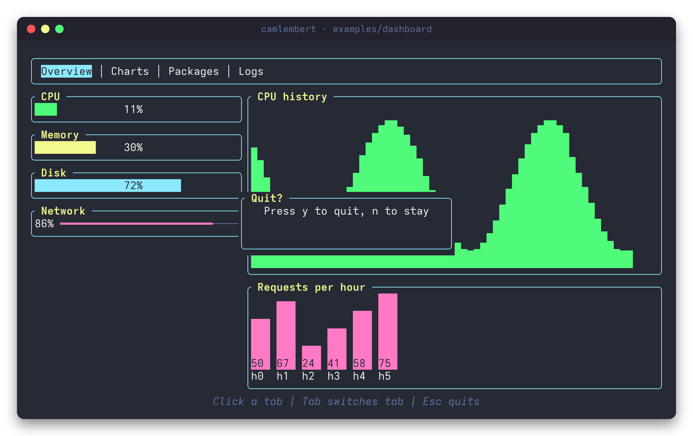
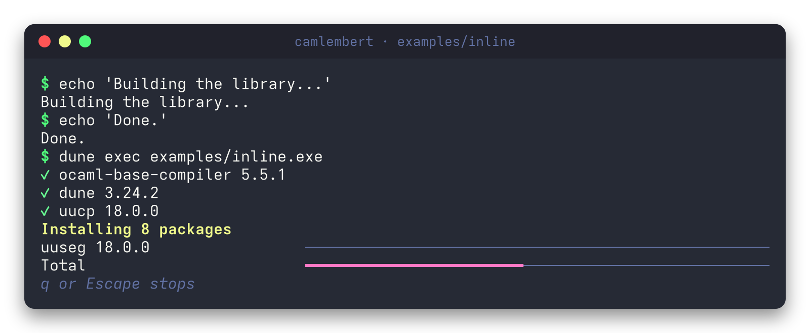
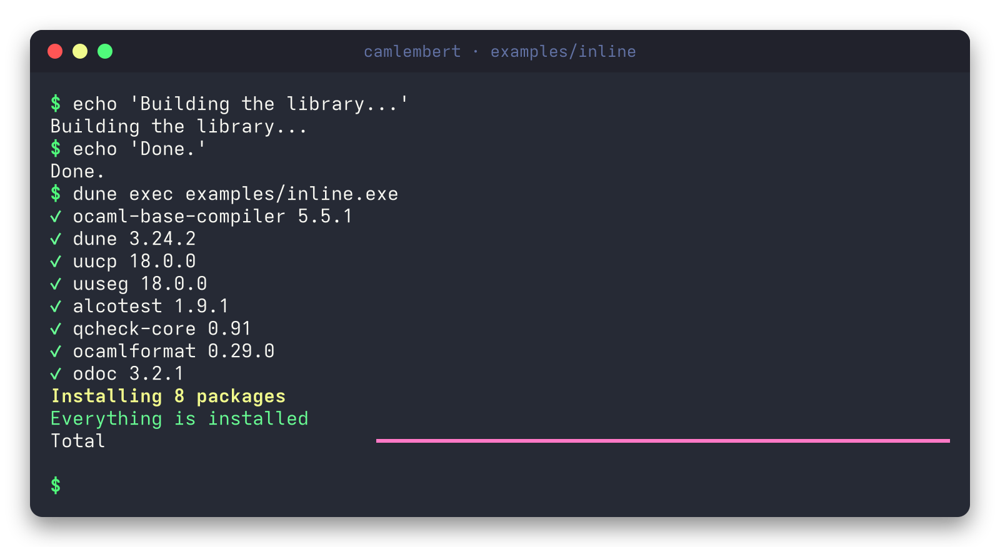
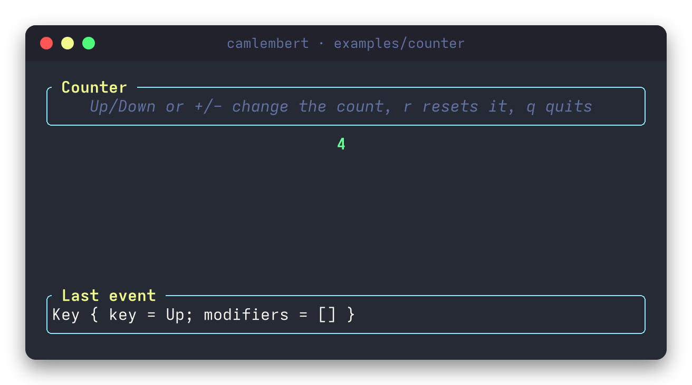

# camlembert

Terminal user interfaces for OCaml, ported from Rust's
[Ratatui](https://github.com/ratatui/ratatui).



Camlembert is an immediate-mode library: on every frame you describe the whole
screen by drawing widgets into a buffer. The library compares that buffer with
the previous frame and sends only the cells that changed to the terminal.

## Why

Ratatui shows that a terminal UI library can stay small and predictable:
widgets draw into a cell buffer, and only what changed reaches the terminal.
Camlembert brings that model to OCaml and keeps what makes it pleasant there:

- A widget is a plain function, `Rect.t -> Buffer.t -> unit`, so widgets
  compose with ordinary higher-order functions.
- Closed sets are variants (`Event.t`, `Constraint.t`, `Marker.t`, ...), so the
  compiler checks that every case is handled.
- A screen can be tested without a terminal: the backend is a record of
  functions, and an in-memory one comes with the library.

## Features

- **Drawing**: a cell buffer that is compared with the previous frame, 16
  ANSI colors, the 256-color palette, 24-bit colors and text effects. Column
  widths are right for CJK, emoji and combining marks.
- **Layout**: split a region with lengths, percentages, ratios, minimums,
  maximums and weighted fill, with optional spacing; center a popup in a region.
- **Widgets**: `Block` (four border types, title, footer, padding),
  `Paragraph` (alignment, wrapping, scrolling), `Gauge`, `Line_gauge`, `Tabs`,
  `Item_list`, `Table`, `Scrollbar`, `Sparkline`, `Bar_chart`, `Canvas`,
  `Chart`, `Text_field` and `Clear`.
- **Canvas and charts**: points, lines, rectangles and circles drawn with
  Braille patterns, half blocks, blocks or bullets, and line or scatter
  datasets between two axes with labels, titles and a legend.
- **Input**: keyboard with modifiers, mouse, bracketed paste and resize
  events, read by a pure parser that accepts sequences in pieces, and helpers
  that tell which row or tab a click landed on.
- **Terminal**: a Unix backend with raw mode and ANSI output, drawing on the
  whole screen or in a few rows below the prompt (an inline viewport), and an
  in-memory backend for tests.

## Gallery

Every picture is a real run of one of the [examples](examples), taken with
[`tools/screenshots`](tools/screenshots).

**Line charts and a canvas.** Two datasets between axes, with labels, titles
and a legend, next to a radar drawn on a canvas. Both are drawn with Braille
patterns, two dots wide and four tall in every cell.



**A table with a filter.** Type to filter, move with the arrow keys or click a
row. The footer is part of the block that frames the table.



**A popup.** `Clear` blanks a region and `Rect.centered` finds where a smaller
one goes, so a dialog can sit over anything.



**Below the prompt.** An inline viewport takes a few rows under the cursor
instead of the whole screen. Finished packages are printed above it with
`Terminal.insert_before`, and they stay in the terminal history.



When the program ends, the last frame stays where it was and the prompt comes
back right under it.



**Keys.** A counter that shows the last event it received.



## Installation

Camlembert is not published to opam yet. Pin it from GitHub:

```bash
opam pin add camlembert https://github.com/AF2B/camlembert.git
```

Add `#v1` to the URL to pin a release instead of the latest commit. It needs
OCaml 5.1 or later; opam installs `uucp` and `uuseg` for you. The Unix backend
has a small C stub, so a C compiler is needed as well. It was developed and
tested on Linux.

Then list the libraries in your `dune` file:

```dune
(executable
 (name main)
 (libraries camlembert camlembert.unix))
```

`camlembert` has the widgets, the layout, the buffer, the terminal and the
in-memory test backend, and does no I/O. `camlembert.unix` adds the backend for
real terminals: raw mode, ANSI output and the reader of keys, mouse and resizes.
Without opam, copy the repository into your project, for example as a git
submodule in `vendor/camlembert`, and dune builds it along with your code.

Give modules short aliases instead of writing `open Camlembert`: `Buffer`,
`Text`, `Line` and `Event` would hide common names.

## Quick start

```ocaml
module Block = Camlembert.Block
module Frame = Camlembert.Frame
module Line = Camlembert.Line
module Paragraph = Camlembert.Paragraph
module Terminal = Camlembert.Terminal
module Text = Camlembert.Text

let greeting =
  Paragraph.make
    ~block:(Block.make ~borders:Block.all_sides ~title:(Line.of_string " Hello ") ())
    (Text.of_string "Terminal UIs for OCaml")

let render_frame frame =
  Frame.render_widget frame (Paragraph.widget greeting) ~area:(Frame.area frame)

let () =
  Camlembert_unix.Unix_backend.with_terminal (fun terminal ->
    Terminal.draw terminal render_frame;
    ignore (In_channel.input_char In_channel.stdin))
```

`with_terminal` puts the terminal in raw mode on the alternate screen and puts
it back when the function returns, raises, or the program is interrupted.

### A program that reacts to keys

The loop is yours: draw a frame, wait for an event, change the state, repeat.

```ocaml
module Alignment = Camlembert.Alignment
module Block = Camlembert.Block
module Event = Camlembert.Event
module Frame = Camlembert.Frame
module Line = Camlembert.Line
module Paragraph = Camlembert.Paragraph
module Terminal = Camlembert.Terminal
module Input = Camlembert_unix.Input
module Unix_backend = Camlembert_unix.Unix_backend

let view count frame =
  let card =
    Paragraph.make
      ~block:(Block.make ~borders:Block.all_sides ~title:(Line.of_string " Counter ") ())
      ~alignment:Alignment.Center
      [ Line.of_string (string_of_int count) ]
  in
  Frame.render_widget frame (Paragraph.widget card) ~area:(Frame.area frame)

let rec loop terminal events count =
  Terminal.draw terminal (view count);
  match Input.wait events with
  | Event.Key { key = Event.Up; _ } -> loop terminal events (count + 1)
  | Event.Key { key = Event.Down; _ } -> loop terminal events (count - 1)
  | Event.Key { key = Event.Char "q"; _ } -> ()
  | Event.Key _ | Event.Resize _ | Event.Paste _ | Event.Mouse _ ->
    loop terminal events count

let () =
  Unix_backend.with_terminal (fun terminal ->
    loop terminal (Input.create ()) 0)
```

`Input.poll ~timeout` waits for a limited time instead, so the screen can
refresh by itself, as the dashboard example does. Mouse and paste events are
asked for with `with_terminal ~features:[ Mouse; Bracketed_paste ]`.

### Below the prompt

Give `with_terminal` a viewport to draw in a few rows under the cursor instead
of taking over the screen, and print finished work above it:

```ocaml
module Frame = Camlembert.Frame
module Line_gauge = Camlembert.Line_gauge
module Paragraph = Camlembert.Paragraph
module Terminal = Camlembert.Terminal
module Text = Camlembert.Text
module Unix_backend = Camlembert_unix.Unix_backend

let steps = 20
let step_seconds = 0.1

let progress step frame =
  let ratio = float_of_int step /. float_of_int steps in
  Frame.render_widget
    frame
    (Line_gauge.widget (Line_gauge.make ~ratio ()))
    ~area:(Frame.area frame)

let note text frame =
  Frame.render_widget
    frame
    (Paragraph.widget (Paragraph.make (Text.of_string text)))
    ~area:(Frame.area frame)

let () =
  Unix_backend.with_terminal ~viewport:(Terminal.Inline 1) (fun terminal ->
    for step = 0 to steps do
      if step > 0 && step mod 5 = 0
      then
        Terminal.insert_before terminal ~height:1 (note (Printf.sprintf "step %d done" step));
      Terminal.draw terminal (progress step);
      Unix.sleepf step_seconds
    done)
```

## Examples

Four larger examples live in [`examples/`](examples). Run one with
`dune exec examples/<name>.exe`:

- [`hello.ml`](examples/hello.ml) splits the screen into a menu and a greeting.
  Wide characters line up:

  ```
  ╭ Menu ──────────────╮╔ Hello ═══════════════════════════════════════╗
  │• Widgets           │║                  Camlembert                  ║
  │• Layout            │║                                              ║
  │• Buffer            │║Terminal UIs for OCaml, ported from Ratatui.  ║
  │• Backends          │║Wide characters line up: 漢字かな             ║
  │                    │║                                              ║
  │                    │║                         Press any key to quit║
  │                    │║                                              ║
  │                    │║                                              ║
  ╰────────────────────╯╚══════════════════════════════════════════════╝
  ```
- [`counter.ml`](examples/counter.ml) reacts to keys and resizes.
- [`inline.ml`](examples/inline.ml) shows an installer's progress in four rows
  below the prompt and prints each finished package above it.
- [`dashboard.ml`](examples/dashboard.ml) has four tabs: gauges, a line gauge, a
  sparkline and bars that move by themselves; a line chart next to a radar
  drawn on a canvas; a filter and a table; and a log that scrolls. It works with
  the keyboard and with the mouse: click a tab or a row, turn the wheel, paste
  into the filter. Escape asks to quit with a popup.

The examples use made-up data. They are built only with the library, to show
how its pieces fit together; they are not part of it.

## How it works

```
widgets ──draw──▶ Buffer ──diff──▶ changed cells ──▶ Backend ──▶ terminal
                    ▲
                    └── the previous frame
```

1. A widget is a plain function `Rect.t -> Buffer.t -> unit`. It draws itself
   into the region it is given.
2. `Terminal.draw` hands a fresh frame to your function, then compares the
   finished buffer with the previous one using `Buffer.diff`.
3. Only the changed cells go to the `Backend`, a record of functions. The
   Unix backend turns them into ANSI escape sequences, moving the cursor and
   changing the style only where needed.

Widgets compose as ordinary functions: `Widget.split` draws several widgets in
one region, each in the share its layout constraint asks for, and
`Stateful_widget.with_state` binds the state of widgets such as `Item_list` and
`Table`.

A terminal takes the whole screen by default. With an inline viewport it stays
on the normal screen instead and draws in some rows below the cursor, leaving
what is above untouched. `Terminal.insert_before` prints lines above those rows,
where they stay as history, and `Terminal.finish` leaves the cursor below the
last frame (`with_terminal` calls it for you).

## Testing a screen

Because the backend is the only part that talks to the outside world, widgets
can be tested without a terminal:

```ocaml
module Block = Camlembert.Block
module Frame = Camlembert.Frame
module Paragraph = Camlembert.Paragraph
module Terminal = Camlembert.Terminal
module Test_backend = Camlembert.Test_backend
module Text = Camlembert.Text

let () =
  let screen = Test_backend.create ~width:12 ~height:3 in
  let terminal = Terminal.create (Test_backend.backend screen) in
  let hello =
    Paragraph.make ~block:(Block.make ~borders:Block.all_sides ()) (Text.of_string "hi")
  in
  Terminal.draw terminal (fun frame ->
    Frame.render_widget frame (Paragraph.widget hello) ~area:(Frame.area frame));
  assert (
    Test_backend.to_lines screen
    = [ "┌──────────┐"; "│hi        │"; "└──────────┘" ])
```

The in-memory terminal also keeps its cursor and scrolls like a real one, so
inline viewports can be tested too.

## Modules

| Module | Role |
| --- | --- |
| `Rect`, `Position`, `Color`, `Style`, `Cell`, `Buffer` | The cell grid widgets draw into, and the diff between two frames |
| `Grapheme` | Splitting text into user-perceived characters and measuring terminal columns |
| `Layout`, `Constraint` | Splitting a region with lengths, percentages, ratios, minimums, maximums and fill, with optional spacing |
| `Widget`, `Stateful_widget`, `Frame`, `Terminal`, `Backend` | Drawing frames on the whole screen or in some rows below the prompt, composing widgets and sending the diff to a backend |
| `Test_backend` | An in-memory terminal to test widgets |
| `Event`, `Input_parser` | Keyboard, mouse, paste and resize events, and the parser that turns terminal bytes into them |
| `Alignment`, `Span`, `Line`, `Text`, `Wrap` | Styled text, and breaking long lines into rows |
| `Block`, `Paragraph`, `Gauge`, `Line_gauge`, `Tabs`, `Scrollbar`, `Sparkline`, `Bar_chart`, `Clear` | Widgets that keep no state |
| `Marker`, `Canvas`, `Chart` | Drawing with Braille patterns, half blocks and blocks: shapes and labels on a canvas, and datasets between two axes |
| `Selection`, `Item_list`, `Table` | Widgets with a selected row that scrolls |
| `Line_edit`, `Text_field` | A line of text being edited, and the box that shows it |
| `Eighths` | Fractions of a cell drawn with block characters, used by the gauges and the charts |
| `Camlembert_unix` (`camlembert.unix`) | The Unix backend: `Unix_backend`, `Input`, `Ansi` and `Tty` |

## Documentation

Every public function documents each of its parameters. Build the API
documentation with:

```bash
dune build @doc
```

and open `_build/default/_doc/_html/index.html`. `odoc` prints one warning for
each `@raise` of a Stdlib or Unix exception, because those libraries are not
part of the generated pages. Those warnings are harmless; any other one is a
broken reference.

## Status

Early development. The library is usable, and the examples show most of it,
but the API may still change. Releases are tagged `v1`, `v2`, `v3`, and so on,
and the [changelog](CHANGELOG.md) lists what changed in each one.

Not there yet: Windows support, and a few widgets Ratatui has, such as a
calendar.

## Repository layout

```
src/core/      cells, buffer, styles, text measuring and layout
src/input/     keyboard and resize events, and the byte parser
src/render/    widget, frame, terminal and backends
src/widgets/   text and every built-in widget
unix/          the Unix backend (ANSI sequences, raw mode, window size, input)
test/          unit and property-based tests
examples/      runnable examples
docs/images/   the pictures used by this file
tools/         the script that takes those pictures
```

## Development

Install the dependencies and the tools once:

```bash
opam install . --deps-only --with-test
opam install ocamlformat.0.29.0 ocaml-lsp-server odoc
```

Then:

```bash
dune build @all @fmt   # build, with strict warnings, and check the formatting
dune test              # unit tests (Alcotest) and property-based tests (QCheck)
dune fmt               # format the code
```

Branches follow `<type>/<short-description>` and commits follow
[Conventional Commits](https://www.conventionalcommits.org/), in English.
Changes worth knowing about go in [CHANGELOG.md](CHANGELOG.md).

The pictures in the gallery are taken by
[`tools/screenshots/capture.sh`](tools/screenshots/capture.sh), which runs the
examples in a private `tmux`, draws their screens as terminal windows and
converts them to PNG with `rsvg-convert`. It needs `tmux`, `python3`,
`rsvg-convert` and the Adwaita Mono font.

## License

MIT. Camlembert derives from Ratatui, which is also MIT licensed; both
copyright notices are kept in [LICENSE](LICENSE).
